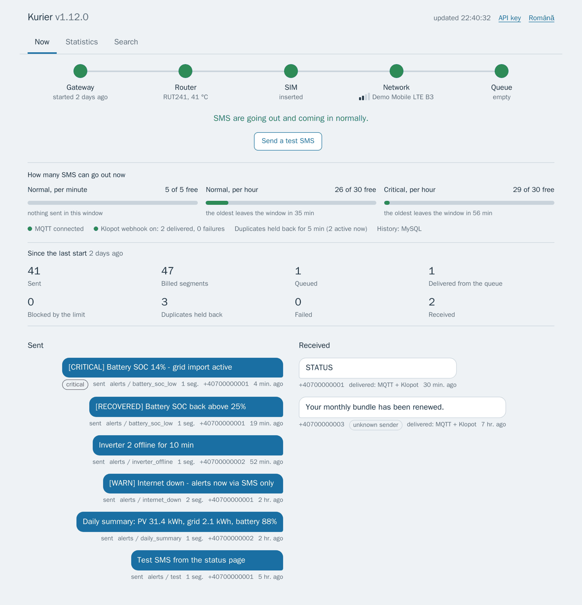

<h1>
  <picture>
    <source media="(prefers-color-scheme: dark)" srcset="docs/brand/kurier-wordmark-dark.svg">
    
  </picture>
</h1>

**SMS transport for self-hosted systems, through a Teltonika LTE router.**
Your services send SMS over a small REST/MQTT API; SMS received by the
router come back to them over MQTT or a webhook. Kurier carries messages
both ways and never interprets them — alert logic and bots stay in your
own services.

It was built for the moment everything else is down: when the internet
connection drops, Telegram and e-mail go with it, but an SMS over LTE
still reaches your phone. Kurier makes that path reliable: it queues
what the router can't take, retries, refuses floods, and tells you when
the SMS path itself is broken.

[Română](README.ro.md)



*The status page (demo data). [Statistics in dark mode](docs/img/statistics-dark.png).*

## What it does

- **Send** — `POST /api/sms/send` or MQTT `sms-gateway/send`. Numbers
  normalized to E.164, text transliterated to GSM-7 (a 320-character
  alert costs 3 SMS instead of 5), rate limits with a separate budget for
  critical alerts, duplicate suppression by alert key, idempotent retries.
- **Never lose an accepted SMS** — if the router is unreachable the
  message is stored and acknowledged with `202`, then retried with backoff
  until delivered or expired.
- **Receive** — every SMS the router gets is archived once, delivered once
  to MQTT and to an optional webhook (e.g. Klopot's `sms_inbox` input),
  then deleted from the SIM. Flags `authorized` (known sender) and
  `stale` (too old to act on) let consumers decide safely.
- **Observe** — a status page (`/ui`): the SMS path hop by hop (gateway →
  router → SIM → network → queue), the live sending budget, a per-day
  chart of what was sent and blocked, the noisiest alert types and full
  history search. Health, metrics and modem status as JSON and MQTT.

## How it fits

```
  your services ──REST / MQTT──▶ ┌──────────┐ ──REST/ubus──▶ ┌──────────────┐ ──LTE──▶ 📱
  (alerting,                     │  Kurier  │                │  Teltonika   │
   automation)  ◀─MQTT/webhook── └──────────┘ ◀──gsmctl───── │  RutOS router│ ◀─LTE──  📱
                                     │                        └──────────────┘
                              MySQL (optional): history, outbox,
                              inbound archive, idempotency keys
```

## Quick start

Requirements: Docker with Compose v2, a Teltonika router with an SMS-capable
modem and RutOS 7.x (tested on a RUT241), reachable from the Docker host.

```bash
git clone https://github.com/sm26449/kurier.git && cd kurier
./install.sh
```

The installer asks for the router's address and login, your phone number
and how you want to run it; it generates the secrets, checks that the
router accepts the login, writes `.env`, starts the containers and offers
to send a test SMS. Run it again whenever you want to change something.

By default you get Kurier with a bundled MySQL (schema created on first
start) and a daily backup into `./backups`. Prefer to do it by hand?
`cp .env.example .env`, edit it, `docker compose up -d --build` —
[docs/INSTALL.md](docs/INSTALL.md) has every step.

Then:

```bash
curl http://127.0.0.1:5080/api/health
curl -X POST http://127.0.0.1:5080/api/sms/send \
  -H "X-API-Key: $SMS_API_KEY" -H 'Content-Type: application/json' \
  -d '{"message": "Hello from Kurier"}'
```

and open **http://127.0.0.1:5080/ui** (it asks for the API key once).

First time? [docs/INSTALL.md](docs/INSTALL.md) walks through it step by
step, including the router settings Kurier depends on (JSON-RPC is off by
default on RutOS). Router details and quirks:
[docs/TELTONIKA.md](docs/TELTONIKA.md).

## Deployment options

| Compose files | Use |
|---|---|
| `compose.yaml` + `compose.mysql.yaml` + `compose.backup.yaml` | standalone, bundled MySQL, daily backups (default) |
| `+ compose.traefik.yaml` | adds its own Traefik with Let's Encrypt (HTTP-01 or DNS-01), IP allowlist |
| `compose.yaml` + `compose.proxy.yaml` | behind a Traefik you already run (Docker or file provider) |
| `compose.yaml` alone | external MySQL (`MYSQL_HOST`…) or none at all (in-memory); add `compose.backup.yaml` for backups |

Details, TLS for LAN-only hostnames, upgrades and backups:
[docs/DEPLOY.md](docs/DEPLOY.md).

## Using it

```json
POST /api/sms/send
{"message": "Battery 14 % — below the critical threshold",
 "severity": "critical", "dedup_key": "soc_critical",
 "idempotency_key": "delivery-1234", "source": "alerting"}
```

Only `message` is required. Answers `200` sent · `202` queued ·
`409` duplicate · `429` rate-limited (`Retry-After`). The full contract,
MQTT topics and the inbound payload: [docs/API.md](docs/API.md).

## Documentation

| | |
|---|---|
| [docs/INSTALL.md](docs/INSTALL.md) | step by step, from router settings to the first SMS, with what to expect |
| [docs/INTEGRATIONS.md](docs/INTEGRATIONS.md) | Home Assistant, Node-RED, Grafana, Uptime Kuma, Alertmanager, scripts |
| [docs/API.md](docs/API.md) | send/receive contract, status codes, idempotency, MQTT topics, health |
| [docs/ARCHITECTURE.md](docs/ARCHITECTURE.md) | components, data flows, design decisions |
| [docs/DEPLOY.md](docs/DEPLOY.md) | compose overlays, TLS, configuration reference, upgrades |
| [docs/TELTONIKA.md](docs/TELTONIKA.md) | router prerequisites and quirks |
| [docs/OPERATIONS.md](docs/OPERATIONS.md) | status page, metrics, monitoring, troubleshooting |
| [docs/INTEGRATION_KLOPOT.md](docs/INTEGRATION_KLOPOT.md) | wiring Kurier to the Klopot notification service |
| [SECURITY.md](SECURITY.md) | reporting and hardening |
| [CHANGELOG.md](CHANGELOG.md) | release history |

## Security

Kurier can spend your SIM credit. The API refuses to run without
`SMS_API_KEY`; keep it off the
internet (loopback by default; the proxy overlays add an IP allowlist), and
treat received SMS as untrusted input. See [SECURITY.md](SECURITY.md).

## License

Apache License 2.0 — see [LICENSE](LICENSE) and [NOTICE](NOTICE).

---

## Who carries the messages

Kurier was built by **[Stefan Maldaianu](https://github.com/sm26449)** — owner
of the SIM card, the router on the shelf and the phone that has to ring
when everything else is down — and **[Claude](https://claude.ai)**
(Anthropic), who wrote most of the code, measured the modem until it
confessed its timestamps were in UTC, and still counts SMS segments in
its sleep.

One of us decides where the messages should go. The other makes sure they
get there — even when the router is having a bad day.
