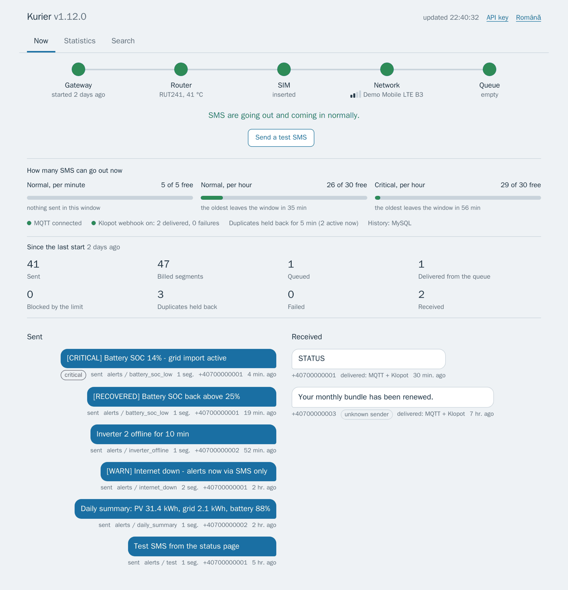

# Kurier

**Transport SMS pentru sisteme self-hosted, printr-un router LTE Teltonika.**
Serviciile tale trimit SMS printr-un API REST/MQTT mic; SMS-urile primite de
router ajung înapoi la ele pe MQTT sau printr-un webhook. Kurier duce mesajele
în ambele sensuri și nu le interpretează niciodată: logica alertelor și
boturile rămân în serviciile tale.

E făcut pentru momentul în care pică tot restul: când cade internetul,
Telegram și e-mailul cad odată cu el, dar un SMS prin LTE tot ajunge pe
telefon. Kurier face drumul acesta sigur: pune în coadă ce routerul nu poate
prelua, reîncearcă, oprește avalanșele și îți spune când chiar drumul SMS e
stricat.

[English](README.md)



*Pagina de stare (date demonstrative). [Statistici în modul întunecat](docs/img/statistics-dark.png).*

## Ce face

- **Trimite** — `POST /api/sms/send` sau MQTT `sms-gateway/send`. Numerele
  sunt aduse la E.164, textul e transliterat în GSM-7 (o alertă de 320 de
  caractere costă 3 SMS-uri în loc de 5), limite de rată cu buget separat
  pentru alertele critice, oprirea duplicatelor după cheia alertei,
  reîncercări idempotente.
- **Nu pierde un SMS acceptat** — dacă routerul nu răspunde, mesajul e
  salvat și confirmat cu `202`, apoi reîncercat până pleacă sau expiră.
- **Primește** — fiecare SMS primit de router e arhivat o dată, livrat o
  dată pe MQTT și opțional printr-un webhook (de exemplu inputul `sms_inbox`
  din Klopot), apoi șters de pe SIM. Marcajele `authorized` (expeditor
  cunoscut) și `stale` (prea vechi ca să acționezi pe el) îi lasă pe
  consumatori să decidă în siguranță.
- **Se vede** — o pagină de status (`/ui`): drumul SMS-ului verigă cu verigă
  (gateway → router → SIM → rețea → coadă), bugetul de trimitere în timp
  real, un grafic pe zile cu ce s-a trimis și ce s-a blocat, alertele cele
  mai zgomotoase și căutare în tot istoricul.

## Pornire rapidă

Ai nevoie de Docker cu Compose v2 și de un router Teltonika cu modem SMS și
RutOS 7.x (testat pe RUT241), accesibil de pe host.

```bash
git clone https://github.com/sm26449/kurier.git && cd kurier
cp .env.example .env
#   completează TELTONIKA_HOST / TELTONIKA_USER / TELTONIKA_PASS,
#   SMS_API_KEY (obligatoriu — fără el API-ul rămâne închis),
#   SMS_DEFAULT_RECIPIENTS, MYSQL_PASSWORD, MYSQL_ROOT_PASSWORD
docker compose up -d --build
```

Fără build: pune `KURIER_IMAGE=ghcr.io/sm26449/kurier:<versiune>` în `.env`
(imagine publicată, amd64 și arm64) și pornește cu
`docker compose up -d --no-build`.

Configurația implicită pornește Kurier cu un MySQL inclus (schema se creează
la prima pornire) și un backup zilnic în `./backups`. Apoi deschide **http://127.0.0.1:5080/ui** (îți cere cheia
API o singură dată).

Configurarea routerului (utilizator dedicat, permisiuni, particularități):
[docs/TELTONIKA.md](docs/TELTONIKA.md). Variantele de deploy (Traefik propriu
sau existent, TLS pentru un hostname doar din LAN):
[docs/DEPLOY.md](docs/DEPLOY.md).

## Documentație

Documentația detaliată e în engleză:
[API](docs/API.md) · [arhitectură](docs/ARCHITECTURE.md) ·
[deploy](docs/DEPLOY.md) · [router Teltonika](docs/TELTONIKA.md) ·
[operare](docs/OPERATIONS.md) · [integrare Klopot](docs/INTEGRATION_KLOPOT.md) ·
[securitate](SECURITY.md) · [istoric versiuni](CHANGELOG.md).

## Securitate

Kurier poate cheltui creditul SIM-ului. API-ul nu pornește fără `SMS_API_KEY`; nu expune
API-ul pe internet (implicit ascultă doar pe loopback, iar variantele cu
proxy adaugă o listă de IP-uri permise) și tratează SMS-urile primite ca
date nesigure. Detalii în [SECURITY.md](SECURITY.md).

## Licență

Apache License 2.0 — vezi [LICENSE](LICENSE) și [NOTICE](NOTICE).

---

## Cine duce mesajele

Kurier a fost construit de **[Stefan Maldaianu](https://github.com/sm26449)**
— proprietarul cartelei SIM, al routerului de pe raft și al telefonului care
trebuie să sune când pică tot restul — împreună cu
**[Claude](https://claude.ai)** (Anthropic), care a scris cea mai mare parte
din cod, a măsurat modemul până a recunoscut că ora lui e în UTC și încă
numără segmente SMS în somn.

Unul dintre noi hotărăște unde trebuie să ajungă mesajele. Celălalt se
asigură că ajung — chiar și când routerul are o zi proastă.
